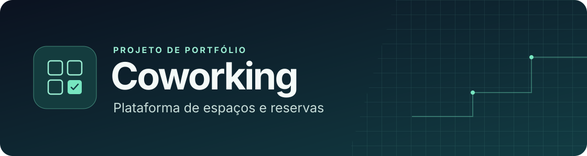
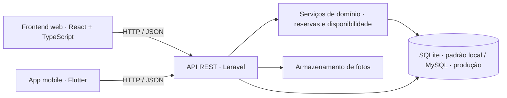

# Coworking

[](https://github.com/Joaovictoreth1/Coworking-/actions/workflows/ci.yml)
[](https://github.com/Joaovictoreth1/Coworking-/actions/workflows/laravel.yml)
[](LICENSE)
[](backend/composer.json)
[](frontend/package.json)
[](mobile/pubspec.yaml)

Projeto de portfólio para descoberta e reserva de espaços de coworking. Visitantes podem explorar o catálogo e consultar disponibilidade. Clientes autenticados podem fazer reservas, salvar favoritos e avaliar espaços. Administradores gerenciam o catálogo, acompanham reservas e consultam métricas. O frontend web e o app Flutter usam a mesma API Laravel.

- [Funcionalidades](#funcionalidades)
- [Arquitetura](#arquitetura)
- [Início rápido](#início-rápido)
- [Configuração](#configuração)
- [API](#api)
- [Testes e CI](#testes-e-ci)
- [Roadmap e contribuição](#roadmap-e-contribuição)

## Funcionalidades

| Área | O que está implementado |
| --- | --- |
| Catálogo | Busca e filtros, detalhes do espaço, fotos, comodidades, avaliações e consulta de disponibilidade. |
| Reservas | Simulação de preço, criação, histórico e cancelamento. O fluxo valida horários e intervalos sobrepostos; há espaços gratuitos e tarifas por hora ou diária. |
| Conta | Cadastro, login por token Bearer, favoritos e publicação ou remoção de avaliações. |
| Gestão | Cadastro de espaços por administradores, gestão de espaços e fotos por administrador ou proprietário, e painel administrativo de reservas e métricas. |

## Arquitetura



**Decisões de implementação.** Os clientes consomem rotas públicas ou enviam um token Bearer nas rotas autenticadas. A API valida a entrada e decide o acesso; a interface não é a fronteira de autorização. O repositório mantém os fluxos `bookings` e `reservations` separados, com regras em `BookingService` e `ReservationService`. Ambos verificam sobreposição; a suíte de concorrência em MySQL complementa os testes em SQLite, que não reproduzem o mesmo comportamento de bloqueios.

| Camada | Tecnologias |
| --- | --- |
| Backend | PHP 8.4, Laravel 13, Eloquent e PHPUnit |
| Web | React 19, TypeScript, Vite 8, Tailwind CSS 4 e ESLint |
| Mobile | Flutter e Dart |
| Dados e infraestrutura | SQLite, MySQL 8, Docker Compose e GitHub Actions |

```text
backend/       API Laravel, migrações, seeders e testes
frontend/      Aplicação web React, estilos e configuração Vite
mobile/        Aplicação Flutter e testes de widgets
docs/assets/   Identidade visual da documentação
.github/       Workflows de CI e modelos de contribuição
```

## Início rápido

### Backend e web com Docker Compose

Pré-requisitos: Git, Docker e o plugin Docker Compose. A partir de um clone novo:

```bash
git clone https://github.com/Joaovictoreth1/Coworking-.git
cd Coworking-
touch backend/database/database.sqlite
docker compose up -d --build
docker compose logs -f backend frontend
```

Na primeira subida, o backend instala dependências, prepara o ambiente e carrega os dados de demonstração. Aguarde os serviços anunciarem que estão ouvindo antes de abrir a aplicação.

| Serviço | Endereço |
| --- | --- |
| Aplicação web | <http://localhost:5173> |
| API | <http://localhost:8000/api/spaces> |
| Verificação de saúde | <http://localhost:8000/up> |
| phpMyAdmin (opcional) | <http://localhost:8081>, com `docker compose --profile tools up -d` |

Por padrão, o Laravel usa SQLite em `backend/database/database.sqlite`. O Compose também sobe MySQL; para usá-lo no desenvolvimento, configure `backend/.env` com `DB_CONNECTION=mysql`, `DB_HOST=db`, `DB_PORT=3306`, `DB_DATABASE=coworking`, `DB_USERNAME=root` e a mesma `DB_PASSWORD` usada pelo Compose. Para encerrar os serviços, use `docker compose down`.

### Backend e web sem contêiner

Use PHP 8.4 com a extensão `pdo_sqlite`, Composer 2 e Node.js 22 LTS (a partir da 22.13) ou 24 LTS. Em um clone novo, execute os blocos em terminais separados, a partir da raiz.

**Backend**

```bash
cd backend
composer install
cp -n .env.example .env
php artisan key:generate
touch database/database.sqlite
php artisan migrate --seed
php artisan storage:link
php artisan serve --host=0.0.0.0 --port=8000
```

**Frontend**

```bash
cd frontend
npm ci
npm run dev -- --port 5173 --strictPort
```

### Aplicativo Flutter

Instale Flutter estável com Dart compatível com `^3.12.2` e configure um emulador Android ou simulador iOS. Inicie a API antes de abrir o app:

```bash
cd mobile
flutter pub get
flutter devices
flutter run --dart-define=API_URL=http://10.0.2.2:8000/api
```

`10.0.2.2` é o alias do host no emulador Android padrão. No simulador iOS, use `http://localhost:8000/api`. Em aparelho físico, informe o IP do computador na mesma rede e confirme que a porta 8000 está acessível. Use HTTPS se a plataforma não permitir HTTP local.

### Contas de demonstração

O seeder de desenvolvimento cria `admin@teste.com` (administrador) e `ana@teste.com` (cliente), ambos com a senha de demonstração `12345678`. Use essas contas somente em desenvolvimento. O seeder é bloqueado em produção; veja o [guia de deploy](DEPLOY.md) para criar o primeiro administrador.

## Configuração

| Escopo | Variável | Finalidade |
| --- | --- | --- |
| [Laravel](backend/.env.example) | `APP_KEY`, `APP_ENV`, `APP_DEBUG`, `APP_URL` | Chave gerada pelo Artisan, ambiente, modo de depuração e URL da API. |
| Laravel | `DB_CONNECTION`, `DB_HOST`, `DB_PORT`, `DB_DATABASE`, `DB_USERNAME`, `DB_PASSWORD` | Conexão com o banco; SQLite é o padrão do exemplo local. |
| Laravel | `COWORKING_TIMEZONE` | Fuso de negócio, `America/Sao_Paulo` por padrão. |
| Laravel | `CORS_ALLOWED_ORIGINS`, `TRUSTED_PROXIES` | Origens autorizadas para CORS e proxies confiáveis; revise as permissões em produção. |
| [Compose local](.env.example) | `DB_DATABASE`, `DB_PASSWORD` | Nome do banco e senha root do serviço MySQL local. Só copie para `.env` na raiz se precisar sobrescrever os valores padrão. |
| [React](frontend/.env.example) | `VITE_API_URL` | Base pública da API, incluindo `/api`; padrão local: `http://localhost:8000/api`. |
| [Flutter](mobile/lib/config.dart) | `API_URL` | Base da API fornecida via `--dart-define`. |

Para publicar, consulte [DEPLOY.md](DEPLOY.md) e [.env.production.example](.env.production.example). Nunca inclua chaves, tokens ou senhas reais nos arquivos de exemplo ou no Git.

## API

Os caminhos abaixo são relativos a `/api`. Use `Accept: application/json` e, quando exigido, `Authorization: Bearer <token>`. A referência completa de rotas é [backend/routes/api.php](backend/routes/api.php).

| Recurso | Método e rota | Acesso |
| --- | --- | --- |
| Conta | `POST /auth/register`, `POST /auth/login` | Público |
| Sessão | `GET /auth/me`, `POST /auth/logout` | Autenticado |
| Catálogo | `GET /spaces`, `GET /spaces/{space}`, `GET /photos/{photo}` | Público |
| Disponibilidade e preço | `GET /spaces/{space}/availability`, `POST /spaces/{space}/bookings/preview` | Público |
| Favoritos | `GET /favorites`, `POST /spaces/{space}/favorite`, `DELETE /spaces/{space}/favorite` | Autenticado |
| Avaliações | `GET /spaces/{space}/reviews`; `POST /spaces/{space}/reviews`, `DELETE /spaces/{space}/reviews/{review}` | Leitura pública; escrita autenticada |
| Reservas (`bookings`) | `GET /bookings`, `GET /bookings/{booking}`, `POST /spaces/{space}/bookings`, `POST /bookings/{booking}/cancel`, `DELETE /bookings/{booking}` | Autenticado |
| Reservas (`reservations`) | `GET /reservations`, `POST /spaces/{space}/reservations`, `DELETE /reservations/{reservation}` | Autenticado |
| Gestão de espaços | `GET /admin/spaces`, `POST /admin/spaces`, `GET` / `PUT` / `PATCH` / `DELETE /admin/spaces/{space}` | Criação: administrador; demais operações: administrador ou proprietário |
| Gestão de fotos e agenda | `POST /admin/spaces/{space}/photos`, `PUT /admin/spaces/{space}/photos/order`, `DELETE /admin/spaces/{space}/photos/{photo}`, `GET /admin/spaces/{space}/reservations` | Administrador ou proprietário |
| Gestão global | `GET /admin/bookings`, `PATCH /admin/bookings/{booking}/status`, `GET /admin/metrics`, `GET /admin/dashboard` | Administrador |

Exemplo de consulta pública com o backend local em execução:

```bash
curl --fail --silent --show-error \
  -H 'Accept: application/json' \
  http://localhost:8000/api/spaces
```

## Testes e CI

Na raiz do repositório, depois de instalar as dependências dos módulos:

```bash
(cd backend && php artisan test)
(cd frontend && npm run lint && npm run build)
(cd mobile && flutter analyze --no-fatal-infos && flutter test)
```

Se o backend estiver no Compose, use `docker compose exec backend php artisan test`. A suíte cobre cadastro e autenticação, permissões, catálogo, avaliações, favoritos e reservas. A configuração padrão usa SQLite em memória; o teste de concorrência específico para MySQL é executado no workflow de backend.

| Workflow | Responsabilidade |
| --- | --- |
| [CI](.github/workflows/ci.yml) | Testes Laravel com SQLite; lint e build do frontend. |
| [Backend](.github/workflows/laravel.yml) | Verificação de estilo com Pint e suíte Laravel em MySQL. |
| [Frontend](.github/workflows/frontend.yml) | Lint e build quando há mudanças no módulo web. |
| [Mobile](.github/workflows/mobile.yml) | Análise estática e testes Flutter quando há mudanças no módulo mobile. |
| [Docker](.github/workflows/docker.yml) | Validação do Compose de produção e build das imagens em PRs relevantes. |

## Roadmap e contribuição

Próximos passos propostos, não funcionalidades entregues: documentar o contrato da API em OpenAPI, automatizar a jornada de reserva no navegador e avaliar a consolidação dos dois fluxos de reserva. Consulte o [roadmap](ROADMAP.md) e o [changelog](CHANGELOG.md) para conhecer o contexto e acompanhar as mudanças.

Para contribuir, siga o [guia de contribuição](CONTRIBUTING.md) e o [código de conduta](CODE_OF_CONDUCT.md). Use a [política de segurança](SECURITY.md) para reportar vulnerabilidades de forma privada.

## Licença e autoria

Distribuído sob a [licença MIT](LICENSE).

**João Victor** · [@Joaovictoreth1](https://github.com/Joaovictoreth1)
