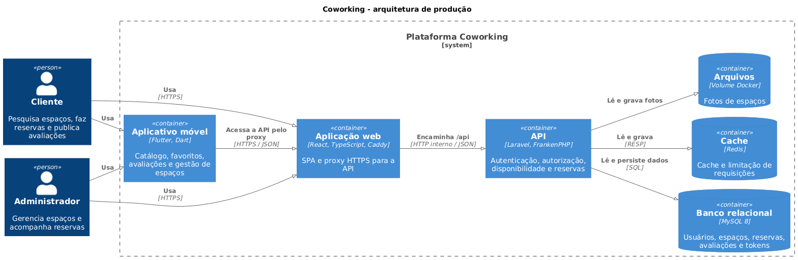

# 🏢 Coworking Platform — Sistema Completo de Gestão e Reservas

[](https://github.com/Joaovictoreth1/Coworking-/actions/workflows/ci.yml)
[](backend/)
[](frontend/)
[](frontend/)
[-red?style=flat-square&logo=laravel)](backend/)
[](frontend/)

Uma plataforma moderna e escalável para **descoberta, agendamento e gerenciamento de espaços de coworking, salas de reunião, escritórios privativos e auditórios**. 

A solução integra **Backend robusto em Laravel 13**, **Frontend web em React 19 com TypeScript**, **Mobile em Flutter** e banco de dados relacional com validação estrita contra **conflitos de horário (Double-Booking)**.

---

## 📐 Arquitetura do Sistema



Em produção, Caddy serve o frontend e encaminha a API. O Laravel usa MySQL para dados, Redis para cache e um volume persistente para fotos. O aplicativo Flutter usa a mesma API.

<details>
<summary>Visão simplificada do fluxo web</summary>

```
                  ┌────────────────────────────────────────┐
                  │          React 19 + TypeScript         │
                  │   Vite, TailwindCSS, TanStack Query,   │
                  │             Zustand Stores             │
                  └───────────────────┬────────────────────┘
                                      │ HTTP / JSON (Bearer Token)
                                      ▼
                  ┌────────────────────────────────────────┐
                  │            Laravel 13 API              │
                  │      PHP 8.4, Service Layer, ORM       │
                  ├────────────────────────────────────────┤
                  │  • BookingService (Double-Booking Lock)│
                  │  • AuthenticateApiToken & EnsureAdmin  │
                  │  • FormRequests & API Resources        │
                  └───────────────────┬────────────────────┘
                                      │
                   ┌──────────────────┴──────────────────┐
                   ▼                                     ▼
        ┌─────────────────────┐               ┌─────────────────────┐
        │     MySQL 8.0       │               │   SQLite In-Memory  │
        │   (Docker Prod/Dev) │               │   (Testes Rápidos)  │
        └─────────────────────┘               └─────────────────────┘
```
</details>

---

## ⚡ Regras de Negócio Críticas

1. **Blindagem contra Double-Booking (Conflito de Horário):**
   - O `BookingService` executa validação matemática de sobreposição: uma reserva sobrepõe outra se `[start_time < new_end]` e `[end_time > new_start]`.
   - No MySQL, a criação e a reativação de bookings serializam as escritas do mesmo espaço com `lockForUpdate` sobre a linha do espaço.
   - Tentativas de sobreposição retornam status **`422 Unprocessable Entity`** com mensagem clara de erro.
2. **Cálculo Automático de Tarifação:**
   - Calcula a duração em horas (`ceil(diffInMinutes / 60)`).
   - Aplica tarifas por hora (`hourly_price`), pacotes de diárias (`daily_price`) ou modalidade gratuita (`is_free`).
3. **Controle de Acesso Baseado em Papéis (RBAC):**
   - `admin`: Gerenciamento completo de todos os espaços (CRUD), aprovação/rejeição de reservas e acesso a KPIs consolidados.
   - `cliente` / `user`: Descoberta pública de espaços, simulação de preços em tempo real, criação e cancelamento de suas próprias reservas.
4. **Ciclo de Vida das Reservas:**
   - Estados: `pending` ➔ `confirmed` ➔ `completed` ou `cancelled`.

---

## 🔑 Dados de demonstração

Somente para bancos locais descartáveis: defina `COWORKING_DEMO_PASSWORD` com 16 a 72 bytes no `backend/.env` e execute `php artisan db:seed` (ou `docker compose exec backend php artisan db:seed`). O seeder cria, entre outras, as contas `admin@teste.com` e `ana@teste.com`. Executá-lo novamente redefine as senhas dessas contas. Ele não roda automaticamente e é bloqueado fora dos ambientes `local` e `testing`.

---

## 🚀 Como Executar o Projeto Localmente

Pré-requisitos: Docker com Compose v2, ou PHP 8.4.1+ com Composer 2 e Node.js 22.13+ para execução nativa. Para o aplicativo móvel, use Flutter stable com Dart 3.12.2+.

### Opção 1: Via Docker Compose (Recomendado)

O backend, frontend e MySQL sobem juntos. Copie o exemplo e preencha senhas locais distintas antes de iniciar:

```bash
# Na raiz do projeto:
cp .env.example .env
docker compose up -d
```

| Serviço | URL Local | Descrição |
|---|---|---|
| **Frontend Web** | [http://localhost:5173](http://localhost:5173) | Interface React com Hot Reload |
| **Backend API** | [http://localhost:8000](http://localhost:8000) | Servidor Laravel 13 |
| **PhpMyAdmin** | [http://localhost:8081](http://localhost:8081) | Opcional: `docker compose --profile tools up -d` |
| **MySQL** | `db:3306` | Somente na rede do Compose |

O Compose agora conecta o Laravel ao MySQL. Se o ambiente anterior usava SQLite, guarde `backend/database/database.sqlite`; as migrations criam o esquema MySQL, mas não copiam dados. Para um volume MySQL existente, crie o usuário de aplicação e ajuste acessos antes de subir: trocar as variáveis não altera usuários já provisionados.

---

### Opção 2: Execução Nativa Separada

#### 1. Backend (Laravel)
```bash
cd backend
composer install
cp .env.example .env
php artisan key:generate
touch database/database.sqlite
php artisan migrate
php artisan storage:link
php artisan serve --port=8000
```

#### 2. Frontend (React + Vite)
```bash
cd frontend
npm ci
npm run dev
```

#### 3. Mobile (Flutter)

```bash
cd mobile
flutter pub get
flutter run --dart-define=API_URL=http://10.0.2.2:8000/api
```

Esse endereço é para o emulador Android. Para o simulador iOS, use `http://127.0.0.1:8000/api`. Para dispositivos físicos, prefira uma API HTTPS alcançável. O Compose local publica a API apenas em loopback.

### Variáveis de ambiente

| Variável | Local | Uso |
|---|---|---|
| `DB_DATABASE`, `DB_USERNAME`, `DB_PASSWORD`, `DB_ROOT_PASSWORD` | `.env` da raiz (Compose local) ou `.env.production` | Banco MySQL, conta da aplicação e senhas obrigatórias; a conta root é usada só na inicialização do MySQL. |
| `APP_ENV`, `APP_KEY`, `APP_URL`, `APP_DEBUG` | `backend/.env` nativo ou `.env.production` | Gere a chave uma única vez por ambiente. Em produção: `APP_ENV=production`, `APP_DEBUG=false` e URL pública HTTPS. |
| `DB_CONNECTION`, `DB_HOST`, `DB_PORT` | Backend | SQLite na execução local nativa; os arquivos Compose definem a conexão MySQL. |
| `CORS_ALLOWED_ORIGINS` | Backend | Lista de origens web separadas por vírgula. Sem configuração, nenhuma origem externa é autorizada. |
| `TRUSTED_PROXIES` | Backend | IPs/CIDRs de proxies confiáveis; use `*` somente se a API não for acessível diretamente. |
| `COWORKING_TIMEZONE` | Backend | Fuso dos horários de funcionamento, padrão `America/Sao_Paulo`. |
| `COWORKING_DEMO_PASSWORD` | `backend/.env` local | Opcional; habilita a população explícita de dados de demonstração. |
| `VITE_API_URL` | `frontend/.env` ou build | Padrão local `http://localhost:8000/api`; imagem de produção usa `/api`. |
| `API_URL` | Flutter `--dart-define` | URL da API em tempo de build. Use HTTPS em produção. |
| `SITE_ADDRESS`, `HTTP_PORT`, `HTTPS_PORT`, `CACHE_STORE`, `REDIS_CLIENT` | `.env.production` | Domínio e portas do Caddy e cache Redis. |

Em produção, siga [DEPLOY.md](DEPLOY.md) para configurar HTTPS, criar o administrador e fazer backup antes de atualizar. O container da API executa migrations no início por padrão; este branch não adiciona uma migration. Se dados de demonstração já foram usados em um ambiente compartilhado, remova essas contas ou redefina suas senhas antes de publicar.

---

## 🧪 Bateria de Testes Automatizados e Qualidade

### Testes do Backend (PHPUnit / Feature Tests)
A suíte de testes de integração roda em ambiente SQLite isolado em memória:

```bash
# Via container:
docker exec coworking-backend php artisan test

# Ou localmente:
cd backend && php artisan test
```

A suíte MySQL da CI também cobre concorrência com processos independentes. Use um banco de teste descartável para esse modo.
- ✅ Fluxo de cadastro e autenticação por Bearer token
- ✅ Validação contra e-mails duplicados e senhas divergentes
- ✅ Criação de reserva com sucesso e cálculo de preço
- ✅ **Teste obrigatório comprovando erro 422 ao tentar reservar horário conflitante (Double-Booking)**
- ✅ Validação de horário de funcionamento do espaço
- ✅ Listagem e cancelamento de reservas pelo cliente
- ✅ Bloqueio de usuário comum tentando criar espaços de administrador (403)
- ✅ Dashboard administrativo e métricas do sistema

### Validação do Frontend (TypeScript + ESLint + Build)
```bash
# Via container:
docker exec coworking-frontend npm run lint
docker exec coworking-frontend npm run build

# Ou localmente:
cd frontend && npm run lint && npm run build
```

### Validação mobile

```bash
cd mobile
flutter analyze --no-fatal-infos
flutter test
```

---

## 📡 Referência dos Principais Endpoints da API

### Autenticação (`/api/auth`)
| Método | Endpoint | Descrição | Acesso |
|---|---|---|---|
| `POST` | `/api/auth/register` | Cria uma nova conta de usuário | Público |
| `POST` | `/api/auth/login` | Autentica e gera Bearer Token | Público |
| `GET` | `/api/auth/me` | Retorna o perfil do usuário logado | Autenticado |
| `POST` | `/api/auth/logout` | Revoga o token da sessão | Autenticado |

### Espaços Públicos (`/api/spaces`)
| Método | Endpoint | Descrição | Acesso |
|---|---|---|---|
| `GET` | `/api/spaces` | Catálogo paginado com busca e filtros | Público / Opcional |
| `GET` | `/api/spaces/{id}` | Detalhes completos do local e fotos | Público |
| `POST` | `/api/spaces/{id}/bookings/preview` | Simulação em tempo real de preço e disponibilidade | Público |
| `GET` | `/api/spaces/{id}/reviews` | Avaliações do local com paginação | Público |

### Reservas do Cliente (`/api/bookings`)
| Método | Endpoint | Descrição | Acesso |
|---|---|---|---|
| `GET` | `/api/bookings` | Lista as reservas do usuário autenticado | Cliente |
| `POST` | `/api/spaces/{id}/bookings` | Cria uma nova reserva (com validação anti-conflito) | Cliente |
| `GET` | `/api/bookings/{id}` | Detalhes de uma reserva específica | Cliente / Admin |
| `POST` | `/api/bookings/{id}/cancel` | Cancela uma reserva ativa | Cliente / Admin |

### Painel Administrativo (`/api/admin`)
| Método | Endpoint | Descrição | Acesso |
|---|---|---|---|
| `GET` | `/api/admin/metrics` | KPIs (taxa de ocupação, receita estimada, reservas) | Admin |
| `GET` | `/api/admin/bookings` | Listagem geral de reservas com filtros | Admin |
| `PATCH`| `/api/admin/bookings/{id}/status` | Aprova, conclui ou cancela reservas | Admin |
| `POST` | `/api/admin/spaces` | Cadastra novo espaço com comodidades e horários | Admin |
| `PUT`  | `/api/admin/spaces/{id}` | Atualiza dados de um espaço existente | Admin |
| `DELETE`| `/api/admin/spaces/{id}` | Remove um espaço do sistema | Admin |

---

## 📄 Licença

Distribuído sob licença MIT. Desenvolvido com padrões de Engenharia de Software Sênior.
